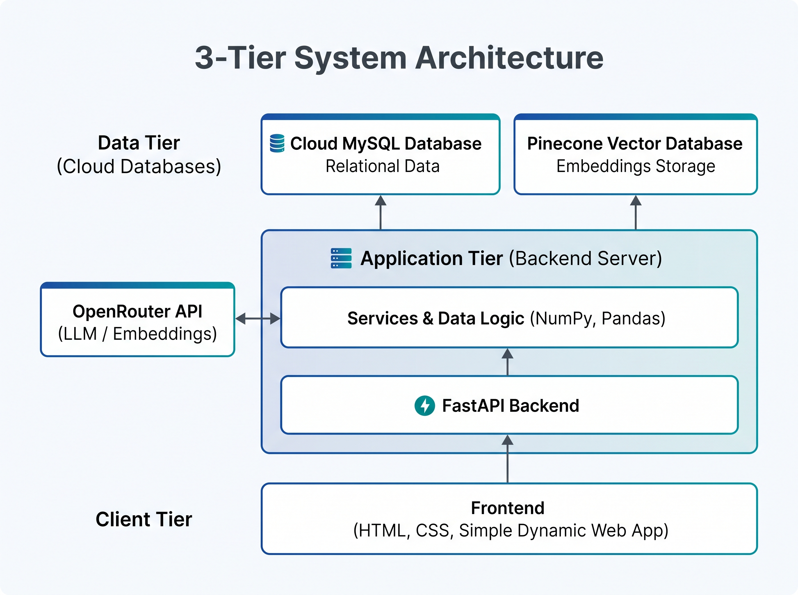

# Book Quote Finder (Backend)

Book Quote Finder is a web application that lets users search for relevant book quotes. It's useful when you remember a quote only partially, or want a quote related to a mood or an idea.

This repository contains the API, database queries, embeddings, and semantic search. The website is in a [separate frontend repository](https://github.com/salishaaaa/Book_quote).

**[Open the website](https://book-quote-finder.vercel.app)** · **[API docs](https://bookquote-api.vercel.app/docs)**



## Try the API

Send a `POST` request to `/get-quotes` with a query and the number of matches you want.

```bash
curl -X POST https://bookquote-api.vercel.app/get-quotes \
  -H "Content-Type: application/json" \
  -d '{"query":"hope and courage","count":3}'
```

The results contain the quote, its attributed author, and a similarity score. The current API returns the result and status code together in a JSON array.

## Features

- Search for book quotes using meaning, not only exact words.
- Get quotes related to a mood, topic, or partially remembered line.
- Generate query embeddings with OpenRouter (`voyageai/voyage-4-lite`).
- Search matching vectors using Pinecone.
- Retrieve quote text and author from MySQL.
- Rank the returned matches using cosine similarity.

## Tech Stack

Python, FastAPI, MySQL, SQLAlchemy, Pinecone, OpenRouter, NumPy, and Pandas. The API is deployed on Vercel.

## Run locally

You'll need Python, Git LFS, a MySQL database, a Pinecone index, and access to the embedding API. The repository doesn't pin a Python version or dependency versions.

```bash
git clone https://github.com/prasoonkandel/Book_quote.git
cd Book_quote
git lfs pull
python -m venv .venv
source .venv/bin/activate
pip install -r requirements.txt
```

Create a `.env` file in the project root:

```dotenv
DB_USER=your_mysql_user
DB_PASSWORD=your_mysql_password
DB_HOST=localhost
DB_PORT=3306
DB_NAME=your_database

OPENROUTER_API_KEY=your_api_key
OPENROUTER_API_URL=https://openrouter.ai/api/v1/embeddings

PINECONE_API_KEY=your_pinecone_key
PINECONE_INDEX_HOST=your_pinecone_index_host
```

The Pinecone index must be configured for **1024-dimensional vectors**, matching the embeddings used by the code. You'll also need a MySQL database and the quote data loaded into it.

For a fresh database, the repository includes scripts to create the `quotes` table, import `data/quotes.csv`, and build the vector index:

```bash
python -m database.create_table
python -m database.seed
python -m vector_db.build_index
```

The CSV is stored with Git LFS, so check that `git lfs pull` downloaded the actual file before running the seed script. These setup scripts require working external service credentials and may need adjustment for your database or data.

Start the server:

```bash
uvicorn app:app --reload
```

Open [http://127.0.0.1:8000/docs](http://127.0.0.1:8000/docs) to try the local API.

## How it works

1. The API receives the text query and the requested quote count.
2. The query is converted into an embedding using OpenRouter.
3. Pinecone finds the closest quote vectors.
4. MySQL provides the quote text and author for those matches.
5. The results are ranked by similarity and returned by the API.

The quote data stays in MySQL, while Pinecone is used for vector search. This makes it possible to find related quotes even when the query doesn't contain the exact words.

## Related Repository

[Book Quote Finder Frontend](https://github.com/salishaaaa/Book_quote) — website built with HTML, CSS, and JavaScript.

## Credits

Backend by [prasoonkandel](https://github.com/prasoonkandel). Frontend by [salishaaaa](https://github.com/salishaaaa).
